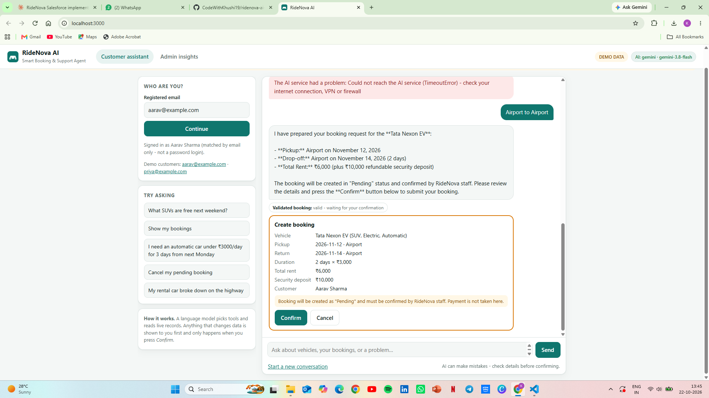

# RideNova AI — Smart Booking & Support Agent

**Agentic AI Hackathon submission** · Built by Khushi (final-year B.Tech CSE) at Meerut institute of engineering and technology meerut. 

RideNova AI turns my existing **RideNova – Vehicle & Fleet Management** Salesforce project into an AI agent. Customers chat in plain language to find free vehicles, check or cancel bookings and raise support tickets. Admins get an insights view of pending bookings and open support issues.

- 🎥 **Demo video (3 min):** _add link here_
- 💻 **Code for the agent:** [`ridenova-agent/`](ridenova-agent/)
- ☁️ **Salesforce project (objects, fields, flows, reports):** [`force-app/`](force-app/)



## Why it is "agentic"

A real language model (Google Gemini; Anthropic Claude is also supported) decides **which tool to call**, reads the result, evaluates it and decides what to do next. The tools are:

| Tool | What it does |
|---|---|
| `search_vehicles` | Finds vehicles free for a date range using real vehicle and booking records |
| `get_my_bookings`, `get_booking` | Looks up the identified customer's own bookings |
| `propose_booking` | Validates a booking and prepares it |
| `propose_cancellation` | Validates a cancellation and prepares it |
| `propose_support_ticket` | Classifies the issue (type and priority) and prepares a ticket |

## Safety by design

- **The AI can only propose changes.** A booking, cancellation or ticket happens only when the user presses **Confirm**, and the backend re-validates everything first.
- Blocks duplicate and overlapping bookings, past dates and invalid values.
- A customer can only see and change their **own** bookings.
- Credentials stay on the server and are never sent to the browser or committed to Git.
- If Salesforce is not connected, the app runs in a clearly labelled **demo mode** with sample data. It never presents demo data as Salesforce data.

## Quick start (demo mode, about 3 minutes)

You need **Node.js 20 or newer** and a **free Gemini API key** from https://aistudio.google.com/apikey. No `npm install` is needed.

```powershell
cd ridenova-agent
copy .env.example .env      # on Mac/Linux: cp .env.example .env
# open .env and set GEMINI_API_KEY=your-key
npm run check-llm           # confirms your key can do tool calling
npm start                   # opens on http://localhost:3000 (demo data when no Salesforce settings exist)
```

Demo customers: `aarav@example.com` and `priya@example.com`. The admin token is printed in the terminal when the app starts.

Try: *"Which SUVs are free for 2 days starting 3 weeks from today?"*, then book one, then *"My rental car broke down on the highway"*.

Free-tier note: Google may use free-tier prompts to improve its products, so use only demo or test data.

## Connecting to a Salesforce org (optional)

Add `SF_INSTANCE_URL` and `SF_ACCESS_TOKEN` (from `sf org display --verbose --json`) to `.env`. Use a **test org or test records**, because the agent creates Pending bookings and tickets. Full steps are in [`ridenova-agent/README.md`](ridenova-agent/README.md).

> Status: the Salesforce connection is implemented and tested against a simulated Salesforce API. A live-org run has not been done yet; this submission demonstrates the agent in demo mode.

## Salesforce objects used

`Vehicle__c`, `Booking__c`, `Support_Ticket__c` and `Contact`. Every field name used is verified against this project's metadata by an automated test (`npm test`).

## Technologies

Salesforce (REST API, existing custom objects and flows) · Node.js backend with no dependencies · Google Gemini function calling · plain HTML/CSS/JavaScript front end · `node:test` (45 automated tests).

## Known limitations

- Customers are identified by email match only, not by login. A real deployment needs authentication.
- Bookings are created as **Pending**; staff confirm them, which matches the project's existing flows.
- Cancelling a booking runs an existing flow that sets the vehicle to Available, even if the vehicle has another active booking.
- `Support_Ticket__c` has no field for the customer's own description, so it is not stored unless an optional field is deployed (see `ridenova-agent/optional-schema/`).
- Sessions are kept in memory, and the free Gemini tier has rate limits.

## Roadmap

Lightning Web Components for the chat and admin views, Apex REST services in place of the Node backend's direct calls, customer login through Experience Cloud, and a deployment pipeline.

## Documentation

- [Architecture and agent workflow](ridenova-agent/docs/ARCHITECTURE.md)
- [3-minute demo script](ridenova-agent/docs/DEMO_SCRIPT.md)
- [Agent README (configuration, security, troubleshooting)](ridenova-agent/README.md)
